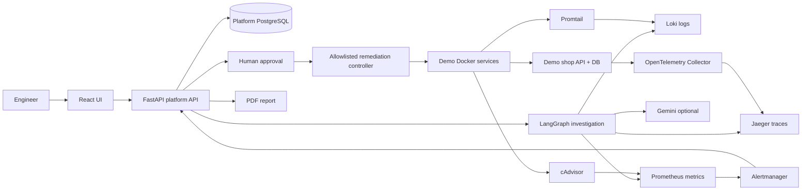

# System architecture

## Trust boundaries

1. The browser never receives database credentials, Gemini credentials, or Docker access.
2. Gemini returns structured recommendations; it does not execute commands.
3. Remediation API validates exact action/target combinations. It does not accept shell strings.
4. The simulator targets only named demo containers. The platform database is not a simulator target.
5. Every remediation requires a persisted human decision. Unique constraints enforce one decision and one execution per plan.
6. Docker socket access is still highly privileged. Only the infrastructure-controller service is attached to the writable internal Docker-proxy network. Promtail uses a separate read-only Docker socket proxy. The platform API cannot directly reach either proxy.

## Service networks

- `platform`: frontend, API, platform PostgreSQL, Redis and the controller API.
- `control-plane` (internal): writable Docker socket proxy and infrastructure controller only.
- `log-control-plane` (internal): read-only Docker socket proxy and Promtail only.
- `demo`: monitored API, demo PostgreSQL, demo frontend, stress containers, API controller connectivity.
- `observability`: Prometheus, Alertmanager, Loki, Promtail, Jaeger, OTel Collector, Grafana, cAdvisor and API query access.

The platform and demo PostgreSQL instances have separate volumes and credentials.
